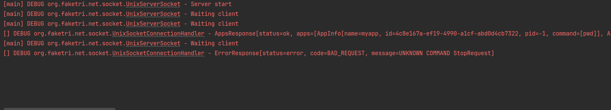
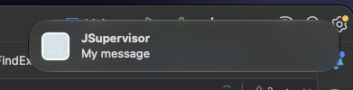
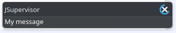
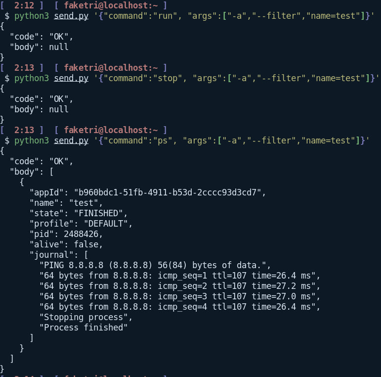
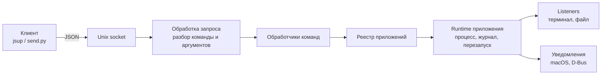

<p align="center">
  
</p>

<h1 align="center" style="padding-top: 0; margin-top: 0">JSupervisor</h1>

<p align="center">
  Лёгкий менеджер процессов на Java: декларативная конфигурация, перезапуск по политике,
  живые логи и управление через Unix domain socket.
</p>

<p align="center">
  
  
  
  
</p>

<p align="center">
  <a href="#возможности">Возможности</a> ·
  <a href="#быстрый-старт">Быстрый старт</a> ·
  <a href="#конфигурация">Конфигурация</a> ·
  <a href="#управление">Управление</a> ·
  <a href="#архитектура">Архитектура</a> ·
  <a href="#roadmap">Roadmap</a>
</p>

---

## О проекте

**JSupervisor** запускает набор процессов из одного YAML-файла, следит за их состоянием,
перезапускает по заданной политике и собирает их вывод. Управлять приложениями можно
командами, отправляемыми через Unix domain socket.

Он подходит, когда нужно держать под присмотром несколько процессов и видеть, что с ними
происходит, а unit-файлы systemd или контейнеры для этого избыточны.

## Возможности

**Управление процессами**
- Запуск, остановка и перезапуск приложений.
- Отслеживание состояния: запущен, завершён, завершился с ошибкой.
- Группировка приложений по профилям и запуск целой группы одной командой.

**Конфигурация**
- Описание приложений в `.yaml`-файлах.
- Несколько приложений в одном файле.

**Перезапуск**
- Политики `ALWAYS`, `ON_FAILURE` и `NEVER` для каждого приложения.

**Наблюдаемость**
- Чтение вывода процесса (`stdout` и `stderr`) в реальном времени.
- Слушатели логов: вывод в терминал и в файл.
- Системные уведомления: macOS и Linux (D-Bus).

**Управление**
- Команды в формате JSON через Unix domain socket.
- Поиск приложений по имени, `pid` или `id`, фильтрация по профилю и состоянию.

## Скриншоты

### Консольный вывод


### Уведомления

|                  macOS                   |              Linux (D-Bus)               |
|:----------------------------------------:|:----------------------------------------:|
|  |  |

### Управление через Unix domain socket


## Быстрый старт

### Требования

- JDK 21 или новее
- Maven
- Linux или macOS (используются Unix domain sockets)

### Сборка

```bash
git clone https://github.com/faketri33/JSupervisor.git
cd JSupervisor
mvn clean package
```

### Конфигурация

Создайте файл `app.yaml`:

```yaml
app:
  test:
    command:
      - ls
```

### Запуск

```bash
java -jar target/<jar> <app.yaml>
```

### Управление

Команды отправляются в виде JSON. Для проверки есть скрипт `send.py`:

```bash
python3 send.py '{"command": "run", "args": ["test"]}'
python3 send.py '{"command": "ps", "args": ["-a"]}'
```

Нативный клиент `jsup` находится в разработке, см. [Roadmap](#roadmap).

## Конфигурация

Приложения описываются в секции `app`. Ключ каждого элемента становится именем приложения.

```yaml
app:
  server:
    command:
      - java
      - -jar
      - server.jar
    restartPolicy: ALWAYS
    profile: DEFAULT

  worker:
    command:
      - ./worker
    restartPolicy: ON_FAILURE
    profile: WORKERS

  test:
    command:
      - ls
    profile: DEFAULT
```

### Параметры

| Параметр        | Описание                                    | Значение по умолчанию |
|-----------------|---------------------------------------------|-----------------------|
| `command`       | Команда и её аргументы для запуска процесса | —                     |
| `restartPolicy` | Политика перезапуска процесса               | `NEVER`               |
| `profile`       | Профиль, к которому относится процесс       | `DEFAULT`             |

`restartPolicy` и `profile` необязательны. Минимальная конфигурация состоит из одной
команды: приложение получит политику `NEVER` и профиль `DEFAULT`.

### Политики перезапуска

| Значение     | Поведение                                                                   |
|--------------|-----------------------------------------------------------------------------|
| `ALWAYS`     | Перезапускать независимо от причины завершения                              |
| `ON_FAILURE` | Перезапускать только при завершении с ошибкой                               |
| `NEVER`      | Не перезапускать                                                            |

Приложение, остановленное пользователем командой `stop`, не перезапускается ни при одной
из политик.

### Профили

Профили объединяют приложения в группы. В примере ниже `backend` и `frontend` относятся к
профилю `DEV`, а `database` к профилю `DATABASE`:

```yaml
app:
  backend:
    command: [java, -jar, backend.jar]
    profile: DEV

  frontend:
    command: [npm, run, dev]
    profile: DEV

  database:
    command: [postgres]
    profile: DATABASE
```

## Управление

Запрос состоит из имени команды и списка аргументов:

```json
{"command": "ps", "args": ["-a", "--filter", "profile=DEV"]}
```

### Команды

| Команда   | Описание                      | Аргументы                          |
|-----------|-------------------------------|------------------------------------|
| `help`    | Список команд                 | —                                  |
| `ps`      | Показать приложения           | `-a`, `--all`, `--filter <k>=<v>`  |
| `run`     | Запустить приложение          | `<приложение>`                     |
| `restart` | Перезапустить приложение      | `<приложение>`                     |
| `stop`    | Остановить приложение         | `<приложение>`                     |

### Как указать приложение

Команды `run`, `restart` и `stop` принимают ровно одно приложение. Тип ссылки определяется
по виду значения:

| Значение                                   | Поиск по   |
|--------------------------------------------|------------|
| `4821` (число)                             | `pid`      |
| `3f2c1a9e-7b4d-4c1a-9e2f-1a2b3c4d5e6f`     | `id`       |
| `server` (всё остальное)                   | имени      |

### Фильтры команды `ps`

По умолчанию `ps` показывает только запущенные приложения. Флаг `-a` показывает все.

| Ключ      | Совпадение                           | Пример                  |
|-----------|--------------------------------------|-------------------------|
| `name`    | подстрока в имени                    | `--filter name=work`    |
| `profile` | точное совпадение                    | `--filter profile=DEV`  |
| `status`  | состояние, без учёта регистра        | `--filter status=failed`|
| `id`      | начало идентификатора                | `--filter id=3f2c1a9e`  |
| `pid`     | точное совпадение                    | `--filter pid=4821`     |

Несколько фильтров объединяются по условию «и»:

```bash
python3 send.py '{"command": "ps", "args": ["-a", "--filter", "profile=WORKERS", "--filter", "status=failed"]}'
```

## Логи и состояние

Вывод процесса можно направлять в разные приёмники без изменения самого процесса:

```text
Process
   │
   ├── stdout ──► Listener ──► Terminal
   │
   └── stderr ──► Listener ──► File
```

Для каждого приложения отслеживается состояние, по которому принимается решение о
перезапуске согласно `restartPolicy`. Его можно увидеть в выводе `ps` и использовать в
фильтре `status=`.

## Архитектура



Сетевой слой ничего не знает о командах, а команды ничего не знают о сети. Каждое
приложение управляется собственным runtime-объектом, который запускает процесс, читает его
вывод и применяет политику перезапуска.

## Roadmap

Реализовано:

- [x] Запуск, остановка и перезапуск процессов
- [x] Отслеживание состояния
- [x] Чтение `stdout` и `stderr`, слушатели логов (терминал, файл)
- [x] Конфигурация через YAML, несколько приложений, профили
- [x] Политики перезапуска
- [x] Системные уведомления (macOS, Linux D-Bus)
- [x] Управление через Unix domain socket

Запланировано:

- [ ] Клиент `jsup` с нативным синтаксисом: `jsup run test`
- [ ] Команда `logs` с параметрами `--tail` и `--follow`
- [ ] Лимит попыток и пауза между автоматическими перезапусками
- [ ] Ограничение доступа к управляющему сокету
- [ ] Справка по командам (`help`)

## Статус проекта

Проект находится в активной разработке (alpha). До версии 1.0 формат конфигурации и
протокол управления могут меняться без обратной совместимости.

## Разработка

```bash
mvn test
```

## Участие в разработке

Вопросы, сообщения об ошибках и идеи приветствуются в разделе Issues. Перед отправкой
Pull Request запустите тесты (`mvn test`) и опишите, что и зачем изменено.

## Лицензия

Распространяется на условиях, указанных в файле [LICENSE](LICENSE).